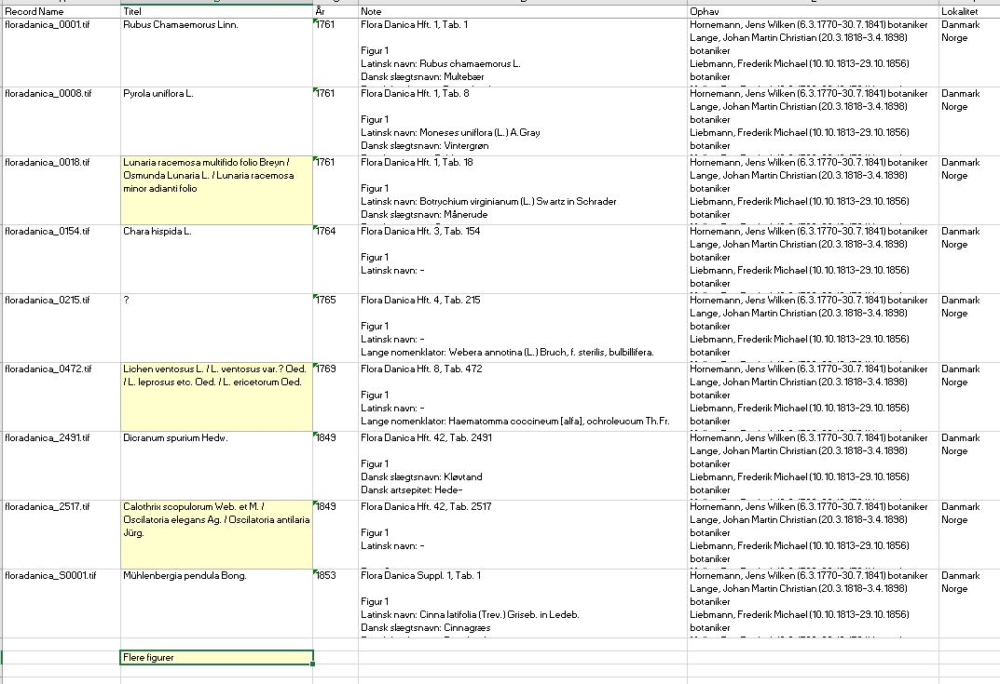

# Typiske fejl

Blok 1. 15 minutter.

## Læringsmål

- Find støj i data i *Taxonomisk gruppe* og i *Hæfte*.
- Undgå uhensigtsmæssige måder at formidle data på.

Kig på *Tavler* og *Noter*.

I *Taxonomisk gruppe* på *Tavler* er der for meget støj. På *floradanica_0001.tif* står der:

*Digitale Samlinger: Digitale Samlinger: Billeder:Særudgivelser:Flora Danica:Taxonomisk gruppe:Karplanter*

Det interessante stykke data er *Karplanter*. Det står efter det sidste kolon. Resten er en sti, som stammer fra, at Flora Danica tidligere har været formidlet på en anden platform.

Stien er forskellig fra række til række. På *floradanica_0001.tif* står *Digitale Samlinger* to gange. På *floradanica_0472.tif* begynder cellen *Digitale Samlinger: Billeder:* og ender på *Laver*. På *floradanica_0154.tif* stopper cellen ved *Taxonomisk gruppe*. På *floradanica_0655.tif* og *floradanica_2517.tif* står der to grupper i samme celle, sat sammen med +.

I *Hæfte* er det interessante det, der står efter *Digitale Samlinger: Billeder:Særudgivelser:Flora Danica:Hæfte:*. På *floradanica_0001.tif* er det *Hft.  1*. På *floradanica_S0001.tif* er det *Suppl. 1*.

På *Noter* står hæftet allerede kort. Noten til *floradanica_0001.tif* begynder *Flora Danica Hft. 1, Tab. 1*.

## Opgave

Arbejdet foregår på *Tavler*. Lad stierne i *Taxonomisk gruppe* og *Hæfte* blive stående.

Skriv overskriften *Gruppenavn* i den første tomme celle til højre for *Hæfte*. Skriv overskriften *Hæfte nr* i cellen ved siden af.

Udfyld de to celler på rækken for hver af disse tavler. I *Gruppenavn* skriver I det, der står efter det sidste kolon. Står der et + i cellen, skriver I begge gruppenavne. I *Hæfte nr* skriver I det, der står efter *Digitale Samlinger: Billeder:Særudgivelser:Flora Danica:Hæfte:*.

- *floradanica_0001.tif*
- *floradanica_0154.tif*
- *floradanica_0472.tif*
- *floradanica_0541.tif*
- *floradanica_0655.tif*
- *floradanica_2517.tif*
- *floradanica_S0001.tif*

## Forslag til resultat

- *floradanica_0001.tif*: *Karplanter*. *Hft.  1*
- *floradanica_0154.tif*: cellen stopper ved *Taxonomisk gruppe*, så *Gruppenavn* er tom. *Hft.  3*
- *floradanica_0472.tif*: *Laver*. *Hft.  8*
- *floradanica_0541.tif*: *Karplanter*. *Hft. 10*
- *floradanica_0655.tif*: *Slimsvampe* og *Svampe*. *Hft. 11*
- *floradanica_2517.tif*: *Alger* og *Lave*. *Hft. 42*
- *floradanica_S0001.tif*: *Karplanter*. *Suppl. 1*

*Hft.  1* har to mellemrum efter punktummet. *Hft. 10* har ét. Skriv det sidste led, som det står i cellen.

## Brug ikke farver til at formidle data

På arket *Noter* er nogle af titlerne fyldt med gul farve. Farven bliver anvendt til at markere de observationer, hvor en tavle har mere end én figur. Det kan I se, fordi den person, som har gennemset dataene, har været hjælpsom, og med gul farve oplyst os om, at der i denne række er beskrivelser af flere figurer i en celle. Det kan give mening for et menneske, der relativt let kan afkode meningen visuelt, men for et computerprogram, så giver det ingen mening. 

Se *floradanica_0018.tif*:

*Lunaria racemosa multifido folio Breyn / Osmunda Lunaria L. / Lunaria racemosa minor adianti folio*

De samme skråstreger står i titlen på *floradanica_0472.tif* og *floradanica_2517.tif*.

Der er flere grunde til, at det er uhensigtsmæssigt at tilføje en oplysning i Excel-arket på den måde. En grund er, at en computer ikke ser, at en celle er fyldt med en farve; og løsningen er at tilføje en ny, tom kolonne og skrive *Flere figurer* i øverste række. Skriv herefter ja i de rækker, hvor titlen har en skråstreg og nej i de øvrige. Værdien er nu data, der svarer på spørgsmålet om, der er flere figurer på tavlen.

En anden grund til at det er uhensigtsmæssigt er, at værdien *Flere figurer* er blevet tilføjet i kolonnen *Titel*, og værdien vil med stor sandsynlighed skabe rod i datasættet, så snart I sorterer teksten i kolonnen i alfabetisk rækkefølge.

[Oversigt](index.md) | [Næste: Formatér data](02-formater-data.md)
